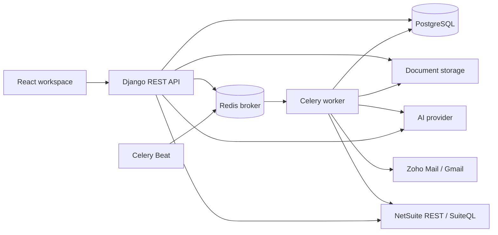

# AGSuite ERP

AGSuite ERP is a multi-tenant application for invoice capture, review, and Oracle NetSuite integration. It helps finance teams turn uploaded documents and incoming vendor emails into structured, validated Vendor Bills while retaining document versions, processing history, and posting results.

The platform includes a company workspace for administrators and employees, plus a Super Admin portal for managing tenants and subscriptions.

## Contents

- [Capabilities](#capabilities)
- [Processing workflow](#processing-workflow)
- [Usage limits and retention](#usage-limits-and-retention)
- [Architecture](#architecture)
- [Repository layout](#repository-layout)
- [Local development](#local-development)
- [Configuration](#configuration)
- [Docker](#docker)
- [Testing](#testing)
- [Deployment and operations](#deployment-and-operations)
- [Troubleshooting](#troubleshooting)
- [Development guidelines](#development-guidelines)

## Capabilities

| Area | Capabilities |
| --- | --- |
| Document processing | PDF and image extraction, multiple-file and ZIP uploads, configurable templates, header and line-item fields, document review and version history; each PDF is limited to five pages and is sent to the AI as one complete document |
| AI configuration | Company-level provider/model configuration plus separate database-backed PDF/file and email extraction prompts |
| NetSuite | OAuth connections, employee connection assignments, field mapping, live reference validation, Vendor Bill posting, background batch jobs, and existing-connection reauthorization |
| Email automation | Zoho Mail and Gmail connections, scheduled fetching, message staging and deduplication, vendor-bill processing, and validation/posting results |
| Access management | Company-scoped access, Company Admin promotion/demotion, invitations with mobile confirmation, JWT authentication, password recovery, email OTP, password visibility controls, and company lifecycle controls |
| Administration | Subscription plans, tenant administration, configurable navigation, notifications, company-wide activity logs, processing usage limits, and operational monitoring |

## Processing workflow

### Document uploads

1. Select an extraction template and upload documents. Single and Multiple modes accept PDF/image files; each individual PDF may contain no more than five pages. ZIP archives are checked file-by-file.
2. Validate the company's file quota, active allocation period, and configured file prompt. In Multiple mode, the total page count of all selected files is checked before any file is processed.
3. Extract structured header and line-item data using the stored company prompt. Template fields with default values are omitted from the AI request and restored from the template afterward; each accepted PDF is submitted as one complete document request.
4. Classify each file as a vendor bill. A file returned with `is_vendor_bill: false` fails with a user-facing message and does not continue as a successful extraction.
5. Apply template defaults and enrich missing mapped references from NetSuite.
6. Review and save the extracted data; calculate applicable line totals and taxes.
7. Validate vendor, item, and other mapped references against the connected NetSuite account.
8. Post a validated Vendor Bill and retain its internal ID and NetSuite record link in history.

### Automated email processing

Connect a mailbox, select its extraction template, and configure the fetching schedule. The schedule is stored per mailbox and is user-configurable: single event, daily, weekly, monthly, or yearly execution; start date/time; repeat interval where applicable; selected weekdays or calendar pattern; and an optional end date. Before AI extraction, the email quota, active allocation period, and company-specific email prompt must all be configured. Background workers fetch and stage messages, classify them as vendor bills, and create processing records only for valid bills; non-vendor messages do not consume email usage.

There is no hardcoded five-minute mailbox processing interval. Celery Beat dispatches each mailbox according to its saved schedule. A separate scheduler-health heartbeat runs every 10 minutes and does not decide when a mailbox should fetch.

### OCR retry behavior

- A successful extraction is marked `COMPLETED` and is not manually retried.
- Manual retry is available only for a failed upload and reprocesses the complete upload.
- Temporary provider/network failures may still use the internal retry policy before the upload is marked failed.

## Usage limits and retention

Super Admins allocate two independent, company-level processing quotas during company creation and can modify them later from the company detail page:

- **PDF/file pages:** consumed by the actual number of pages in each accepted PDF or image upload. A one-page PDF counts as one page; multiple files add their page counts together.
- **Email bills:** consumed once for each vendor-bill email promoted into processing. Non-bill mailbox traffic does not consume an email-bill unit.

Each quota has its own start and end date. Processing is allowed only while the relevant allocation period is active and unused capacity remains. A zero limit, exhausted limit, or expired period blocks the corresponding file or email processing. Current limits, consumed units, remaining units, and period status are visible to Company Admins and employees on the Processing Status page; only Super Admins can change allocations.

The prompt, limit, and start/end dates are linked configuration for each processing type. If any one is missing, that flow is blocked before AI work begins and the user sees the missing setting plus the Super Admin contact email; there is no hardcoded prompt fallback. Multiple file uploads are rejected before AI when their aggregate page count exceeds the remaining file quota. File usage is released for extraction failures and non-vendor files; only successfully processed vendor-bill files retain the page usage.

### Activity logs

The existing audit endpoint is shared by both scopes:

```text
GET /api/v1/audit/events/
```

Activity logs are available only in the Super Admin UI at `/admin/company-logs`. Super Admins see records for all companies, with company ID and company name included for filtering and identification. Company Admins and employees do not have activity-log access. Automated activity logs older than 30 days are purged once per day; manual activity logs are retained.

### Field precedence and NetSuite references

- Configured template defaults replace AI-extracted values for ordinary fields. Default-valued fields are omitted from the AI prompt/schema to reduce context and token usage, then restored from the template. **Location is a source-first exception:** an AI-extracted Location from a PDF, image, or vendor email is retained; the template Location is used only when no Location was extracted.
- Missing mapped subsidiary and location values can be filled from an unambiguously matched vendor's NetSuite record. Existing values are preserved by this vendor fallback.
- When subsidiary and currency are mapped, the subsidiary's base currency replaces the extracted or template currency. Posting fetches currency again using the final resolved subsidiary and sends the NetSuite currency internal ID.
- A failed subsidiary-currency lookup during enrichment clears the old currency value. A failed lookup during posting prevents the bill from being submitted.
- A missing invoice number receives a database-allocated `vendor_bill_inv_<number>` on initial save. Location is resolved through extraction, configuration, or vendor enrichment; there is no hard-coded location default.

Reference lookup and posting depend on the connected account's records, permissions, and transaction rules.

### Account, invitation, and company status rules

- New company users are created as pending accounts and receive an invitation. Invitation acceptance requires the invitee to enter the original national mobile number saved by the administrator; the country calling code is never entered or changed by the invitee.
- A company must have a completed paid plan and be explicitly activated before its company users can log in, accept invitations, use integrations, fetch mailbox messages, or process data.
- Super Admin users can create company users but cannot promote or demote existing company users. Company Admins manage promotion/demotion within their own company; they cannot alter their own role.
- Designation and department are required when creating new employees. Each company has an editable department catalogue seeded with `HR`, `NetSuite`, `IT Support`, and `Development`.
- Password recovery is only for an active, email-verified account that has already completed initial password setup. Pending, inactive, suspended, or unknown accounts receive no reset OTP. A password reset does not bypass invitation mobile confirmation.
- The reset page requires the email state produced by the Forgot Password page; direct navigation returns the user to the recovery form.
- Password and credential inputs provide a show/hide control. OTP resend cooldown messages update their remaining seconds live and indicate when another request can be made.

### Company lifecycle notifications

- Suspending a company requires a Super Admin-entered description. The existing `MANUAL`, `PLAN`, and `DELETED` suspension reason values remain unchanged; the description is stored separately in `suspension_description`.
- After the status update is reflected in the Super Admin UI, the frontend makes a separate Super Admin-only request to send the notification email. This keeps status updates responsive and does not require Celery for these lifecycle notifications.
- Suspension and activation emails are sent only to the company's Company Admin users, not employees. The contact address in these emails is the active platform-level Super Admin address; the configured sender address remains separate.
- Company creation sends a notification to the company's contact email. Completing a subscription transaction sends Company Admins the plan and transaction details. Assigning a plan without completing its transaction does not send that email.

### NetSuite reauthorization

- The NetSuite integration card shows a reconnect warning when the provider-issued refresh token has five days or less remaining. It also shows Reconnect when authorization has expired or the connection is disconnected or in an error state.
- Reconnect does not create a second integration. It reuses the existing connection and stored client credentials, opens a fresh NetSuite OAuth authorization flow, exchanges the returned authorization code for new access and refresh tokens, and updates the existing connection record.
- While the refresh token remains valid, the backend can refresh short-lived access tokens without user interaction. Reauthorization is required after refresh-token expiry, revocation, or an invalid-grant response.

## Architecture



| Component | Technology / responsibility |
| --- | --- |
| Frontend | React 19, Vite 8, React Router, Tailwind CSS, Axios |
| API | Django 6, Django REST Framework, SimpleJWT |
| Database | PostgreSQL for application data, document history, and durable job state |
| Background processing | Celery and Redis; Celery Beat for scheduled work |
| Document storage | Local filesystem, PostgreSQL-backed storage, or S3-compatible storage |
| Deployment | Gunicorn for the API; Nginx for the Docker frontend and reverse proxy |

### Background execution model

The application uses an **event-triggered, traditional background-worker architecture**, not a serverless event-driven runtime. API actions such as uploads and mailbox work create or enqueue work; long-running Celery workers consume Redis-backed tasks, and PostgreSQL retains durable job state, leases, and retry information. Celery Beat dispatches scheduled work, including each mailbox's saved fetch schedule.

OCR and NetSuite jobs can alternatively run in in-process worker threads, inline in the API process, or through the dedicated PostgreSQL-backed `run_ocr_worker` process, according to `OCR_EXECUTION_MODE`. These are execution-mode fallbacks, not serverless functions. The lightweight lazy-housekeeping fallback can start a background thread from the API process, but it is likewise not a serverless invocation.

Automated email processing requires Redis, a Celery worker, and Celery Beat. OCR and NetSuite batch processing also support an in-process execution mode and a dedicated PostgreSQL-backed worker through `run_ocr_worker`. These alternatives do not replace the email scheduler.

Company-scoped services and access controls separate tenant data. Integration credentials and AI API keys use field-level encryption. Keep the encryption key available to every process that reads those records.

## Repository layout

```text
backend/
  config/             Settings, API routes, WSGI, and Celery configuration
  accounts/           Authentication, user profiles, and login workflows
  tenancy/            Companies and tenant lifecycle
  rbac/               Roles and access configuration
  invitations/        User invitation and acceptance workflows
  subscriptions/      Plans and company subscriptions
  superadmin/         Platform administration
  ocr/                Extraction, templates, document history, storage, and jobs
  netsuite/           OAuth, reference validation, mapping, and posting
  mail_integration/   Mailbox connections, synchronization, and bill pipeline
  audit/              Audit records and notifications
  monitoring/         Health, readiness, errors, and API usage
  common/             Shared services and utilities
  dashboard/          Dashboard data
  navigation/         Configurable navigation
  transactions/       Transaction records
frontend/
  src/                Pages, components, routes, contexts, and API services
Dockerfile.backend    Backend container image
Dockerfile.frontend   Frontend build and Nginx image
docker-compose.yml    Local container services and worker profiles
nginx.conf            Frontend serving and API proxy configuration
```

## Local development

### Prerequisites

- Python 3.12 or later; the backend container uses Python 3.12.
- Node.js 22.12 or later and npm.
- PostgreSQL and a development database.
- Redis when running Celery or automated email processing.
- Provider credentials for the integrations you intend to exercise.

Run the following commands from the repository root unless a step changes directories. Examples use PowerShell.

### 1. Prepare the backend

```powershell
python -m venv .venv
.\.venv\Scripts\Activate.ps1
python -m pip install -r backend/requirements.txt
Copy-Item backend/.env.example backend/.env
```

On Linux or macOS, activate with `source .venv/bin/activate` and copy files with `cp`.

The backend example is production-oriented. Before starting locally, update `backend/.env` with development settings:

```dotenv
DJANGO_SETTINGS_MODULE=config.settings.local
DEBUG=True
DJANGO_DEBUG=True
SECRET_KEY=<generated-django-secret>
FIELD_ENCRYPTION_KEY=<generated-fernet-key>
DATABASE_URL=postgresql://<user>:<password>@localhost:5432/<development_database>
ALLOWED_HOSTS=localhost,127.0.0.1
CORS_ALLOWED_ORIGINS=http://localhost:5173
CSRF_TRUSTED_ORIGINS=http://localhost:5173
FRONTEND_URL=http://localhost:5173
SECURE_SSL_REDIRECT=False
JWT_AUTH_COOKIE_SECURE=False
JWT_AUTH_COOKIE_SAMESITE=Lax
NETSUITE_REDIRECT_URI=http://localhost:8000/api/v1/netsuite/callback/
EMAIL_OAUTH_REDIRECT_URI=http://localhost:8000/api/v1/email/callback/
CELERY_BROKER_URL=redis://localhost:6379/0
CELERY_RESULT_BACKEND=redis://localhost:6379/0
# Optional server-side email deliverability verification. Never expose these
# values to the frontend or commit them.
ABSTRACT_EMAIL_VALIDATION_API_KEY=
HUNTER_API_KEY=
```

Generate the two keys separately:

```powershell
python -c "from django.core.management.utils import get_random_secret_key; print(get_random_secret_key())"
python -c "from cryptography.fernet import Fernet; print(Fernet.generate_key().decode())"
```

Replace the example SMTP/Brevo credentials with working development credentials. To use console email delivery locally, leave `EMAIL_HOST` and `BREVO_API_KEY` empty. Register the exact OAuth callback URLs with the relevant providers; use an approved HTTPS development callback where required by provider configuration.

### Outbound email with Zoho SMTP

OTP, invitation, and operational-alert emails use Django SMTP when `EMAIL_HOST` is set and `BREVO_API_KEY` is empty. Zoho's SMTP server details depend on the Zoho data center and account type; use the exact values displayed in Zoho Mail under **Settings → Mail Accounts → Primary Account → SMTP**.

For a Zoho organization mailbox in the India data center using port 465, configure implicit SSL:

```env
EMAIL_HOST=smtppro.zoho.in
EMAIL_PORT=465
EMAIL_HOST_USER=noreply@example.com
EMAIL_HOST_PASSWORD=<Zoho app-specific password>
EMAIL_USE_TLS=False
EMAIL_USE_SSL=True
DEFAULT_FROM_EMAIL=noreply@example.com
DEFAULT_FROM_NAME=AGSuite ERP
BREVO_API_KEY=
```

For a server configured for port 587, use STARTTLS instead: set `EMAIL_USE_TLS=True` and `EMAIL_USE_SSL=False`. The two options are mutually exclusive. When Zoho two-factor authentication is enabled, generate an app-specific password and use it as `EMAIL_HOST_PASSWORD`; never commit it to source control. Restart the backend after changing environment variables.

```powershell
cd backend
python manage.py migrate
python manage.py seed_rbac
python manage.py createsuperuser
python manage.py runserver
```

The API is available at `http://localhost:8000`, with application routes under `/api/v1/`.

Run `makemigrations` only when intentionally creating a model migration. The company prompt fields are persisted by the tracked migration `ocr/migrations/0033_bill_processing_prompts.py`; apply it with `migrate` in every environment and keep it in the release.

### 2. Start background services

Start Redis. In separate terminals, activate the same virtual environment, change to `backend/`, and run:

```powershell
python -m celery -A config worker --loglevel=info --pool=solo
```

```powershell
python -m celery -A config beat --loglevel=info
```

`--pool=solo` is intended here for local Windows development. Keep both processes running for email automation, using the same database, encryption key, and broker configuration as the API. Restart workers after backend changes.

For a dedicated OCR/NetSuite worker without Celery, set `OCR_EXECUTION_MODE=external` and run `python manage.py run_ocr_worker`. Email automation still needs Celery and Beat.

### 3. Start the frontend

In a separate terminal from the repository root:

```powershell
cd frontend
npm ci
Copy-Item .env.example .env
```

Set the following in `frontend/.env`:

```dotenv
VITE_API_BASE_URL=http://localhost:8000/api/v1
```

```powershell
npm run dev
```

Open `http://localhost:5173`. Configure the company, AI provider, NetSuite connection, and extraction template before processing documents. Automated email processing additionally requires an active mailbox and initial sync date.

## Configuration

| Variable | Purpose |
| --- | --- |
| `DJANGO_SETTINGS_MODULE` | Select `config.settings.local`, `config.settings.production`, or dedicated test settings |
| `DATABASE_URL` | PostgreSQL connection string; local configuration also supports `LOCAL_DATABASE_URL` as a fallback |
| `SECRET_KEY` | Django application secret |
| `FIELD_ENCRYPTION_KEY` | Fernet key for encrypted integration credentials and API keys |
| `ALLOWED_HOSTS` | Allowed backend hostnames |
| `CORS_ALLOWED_ORIGINS`, `CSRF_TRUSTED_ORIGINS`, `FRONTEND_URL` | Browser origins and frontend URL |
| `NETSUITE_REDIRECT_URI`, `EMAIL_OAUTH_REDIRECT_URI` | Provider-registered OAuth callbacks |
| `EMAIL_HOST`, `EMAIL_PORT`, `EMAIL_HOST_USER`, `EMAIL_HOST_PASSWORD`, `EMAIL_USE_TLS`, `EMAIL_USE_SSL`, `DEFAULT_FROM_EMAIL`, `BREVO_API_KEY` | Outbound SMTP delivery for OTPs, invitations, and operational alerts; separate from mailbox OAuth. TLS (usually port 587) and SSL (usually port 465) are mutually exclusive. |
| `ABSTRACT_EMAIL_VALIDATION_API_KEY`, `HUNTER_API_KEY` | Server-side email deliverability verification. Abstract is attempted first; Hunter is used when Abstract fails or its quota is unavailable. |
| `CELERY_BROKER_URL`, `CELERY_RESULT_BACKEND` | Celery broker and result service |
| `OCR_EXECUTION_MODE` | Job execution strategy: `auto`, `celery`, `thread`, `inline`, or `external` |
| `OCR_MAX_PAGES` | Maximum pages per individual PDF upload; the application default is `5` |
| `OCR_MULTI_MAX_FILES` | Maximum number of files in Multiple mode |
| `OCR_SINGLE_ASYNC`, `OCR_SINGLE_TIME_BUDGET_SECONDS` | Single-mode execution behavior and inline time budget |
| `OCR_STORAGE_BACKEND` | Document storage: `auto`, `local`, `db`, or `s3` |
| `OCR_S3_*` | S3 bucket, region, endpoint, and optional credentials |
| `VITE_API_BASE_URL` | Frontend API endpoint, embedded at build time |

Use the environment templates as starting points: [backend](backend/.env.example), [frontend](frontend/.env.example), [Docker application](env.docker.example), and [Docker PostgreSQL](env.postgres.example). Runtime settings are defined in `backend/config/settings/`.

Store secrets outside version control. Back up the encryption key securely with your recovery procedures; replacing it without migrating encrypted values makes existing credentials unreadable.

## Docker

Copy both environment templates from the repository root:

```powershell
Copy-Item env.docker.example .env.docker
Copy-Item env.postgres.example .env.postgres
```

Fill in the application keys and database credentials. Keep the PostgreSQL password consistent between both files. The supplied database health check expects `agsuite_user` and `agsuite_erp`; update it if you change those names.

For email automation, enable the following values in `.env.docker`:

```dotenv
CELERY_BROKER_URL=redis://redis:6379/0
CELERY_RESULT_BACKEND=redis://redis:6379/0
REDIS_URL=redis://redis:6379/0
```

Set OAuth callbacks to the externally reachable API URL. With the supplied Nginx configuration and local port 80, callbacks use `http://localhost/api/v1/...`; the backend port is not published directly. Configure outbound email credentials or clear unused example values before starting.

```powershell
docker compose --profile full up -d --build
docker compose ps
docker compose logs -f backend celery_worker celery_beat
```

The frontend is served at `http://localhost`. The backend entrypoint applies migrations, seeds roles, and collects static files.

| Profile | Services |
| --- | --- |
| Default | Frontend, backend, PostgreSQL, Redis, and static-volume initialization |
| `full` | Default services plus Celery worker and Beat |
| `worker` | Default services plus the dedicated OCR/NetSuite worker; use `OCR_EXECUTION_MODE=external` |

Named volumes retain database, Redis, media, and static data. `docker compose down` stops the stack; adding `--volumes` deletes those volumes.

## Testing

Run backend checks from `backend/` with the virtual environment active:

```powershell
python manage.py check
python manage.py test accounts.tests common.tests invitations.tests invitations.test_permissions ocr.tests mail_integration.tests netsuite.tests superadmin.tests --noinput
```

For the full suite, use a dedicated PostgreSQL test server and the repository's test settings. The test user must be able to create the separate test database:

```powershell
$env:DJANGO_SETTINGS_MODULE = "config.settings.testing"
$env:TEST_DATABASE_URL = "postgresql://<test_user>:<password>@localhost:5432/postgres"
$env:TEST_DATABASE_NAME = "test_agsuite"
python manage.py test --noinput
```

Use a separate terminal for these settings so subsequent development commands retain their development configuration.

From `frontend/`:

```powershell
npm run lint
npm run build
```

Integration acceptance checks should cover login, invitation acceptance with the saved mobile number, password recovery for an active account and rejection for a pending account, a document upload, mapped-field validation, and a Vendor Bill posted to a NetSuite sandbox. For email changes, also check scheduled fetching, duplicate handling, disconnect/reconnect behavior, and failure visibility in history. Mocked unit tests do not verify account-specific NetSuite permissions or provider behavior.

OCR acceptance checks should also cover missing prompt/limit/date configuration, aggregate page-limit rejection before AI, `is_vendor_bill: false` rejection for files and emails, default-valued template fields being excluded from the AI request, and usage being retained only for successfully processed vendor bills. Backend tests require a reachable PostgreSQL test database.

## Deployment and operations

Deploy the API, frontend, database, document storage, and required workers as separate operational components. Use persistent/shared document storage when running multiple instances. For automated email workflows, keep Redis, workers, and a single active Beat scheduler available.

A release should create/apply database migrations, collect static assets, rebuild the frontend with the target API URL, and restart backend workers. Configure HTTPS, allowed hosts, browser origins, and provider callbacks for the target environment. Production uses `config.settings.production`; run `python manage.py check --deploy` with the production environment before rollout. Do not rename application tables manually; use Django migrations so the database schema and migration history remain aligned.

| Endpoint / command | Purpose |
| --- | --- |
| `GET /health/` | Basic API liveness |
| `GET /api/v1/monitoring/health/` | Application dependency diagnostics |
| `GET /api/v1/monitoring/readiness/` | Readiness check |
| `python manage.py run_ocr_worker` | Dedicated OCR and NetSuite job worker |
| `python manage.py run_scheduled_tasks` | Housekeeping when scheduled outside Celery Beat |

Monitor mailbox due times and completion results alongside worker and scheduler health. A healthy API alone does not establish that email processing is running. Maintain backups of PostgreSQL, uploaded documents, and encryption keys, and verify restoration in a separate environment.

### Workflow timing

At INFO level, the `performance` logger emits `TIMING` followed by JSON for document preparation/extraction, AI extraction, mailbox fetching, email processing, NetSuite enrichment, reference lookups, SuiteQL, validation, and posting. Each event contains `stage`, `duration_ms`, `trace_id`, `span_id`, `parent_span_id`, `outcome`, and available job/document identifiers. Payloads, credentials, query text, and exception messages are excluded.

Filter backend/worker logs by `TIMING` and then by document/message ID or `trace_id` to compare stages. Nested calls within the same execution context share a trace; traces are not automatically propagated across thread or Celery boundaries. Durations include time spent inside child stages and retries, so do not add parent and child durations together. `netsuite.http_request` includes retry waits, while `netsuite.post_vendor_bill` covers the entire posting service call. These timings measure execution, not queue waiting time.

`outcome=returned` means the function returned normally, including business validation failures or deferred work. `outcome=raised` records an escaping exception and its type. Consult the workflow's result/error logs to determine business success. Changing the effective `performance` logger level above INFO disables these measurements.

Additional deployment notes are available in [DEPLOY.md](DEPLOY.md) and [DEPLOY_ANYWHERE.md](DEPLOY_ANYWHERE.md). For exact service profiles, defaults, and supported options, consult the checked-in Compose file and settings modules.

## Troubleshooting

| Symptom | Check |
| --- | --- |
| API returns `DisallowedHost` | Backend hostname in `ALLOWED_HOSTS` |
| Browser reports CORS/CSRF errors | Frontend origin, trusted origins, cookie settings, and HTTP/HTTPS consistency |
| Frontend calls the wrong API | `VITE_API_BASE_URL` at build time; rebuild after changing it |
| Email passes its displayed due time | Scheduled task queue, worker queue, connection state, and provider response |
| Sync reports `checked: 0` | No mailbox met the active, connected, unpaused, initialized, and due filters |
| Mailbox requires authorization | Reconnect through provider OAuth to restore valid credentials |
| Forgot Password says the account is unregistered or inactive | Use the invitation flow for a pending employee; reactivate the company/account through an administrator before requesting a reset OTP |
| Currency enrichment or posting fails | Subsidiary mapping, subsidiary record, currency availability, and SuiteQL permissions |
| NetSuite rejects a reference | Record status, subsidiary compatibility, field mapping, and integration-role permissions |
| Uploaded files disappear after a restart | Storage persistence and shared access between API and workers |
| Jobs remain queued | Execution mode, worker availability, broker configuration, and job logs |

## Development guidelines

Keep tenant scoping and authorization in place when adding endpoints or background jobs. Add migrations for model changes and focused tests for behavior changes. Validate integration changes with sandbox accounts before production use.

Keep credentials, OAuth tokens, customer documents, and environment files out of commits and diagnostic output. Update this README when setup, supported workflows, or operational requirements change; document deployment-specific configuration in the corresponding environment's runbook.
