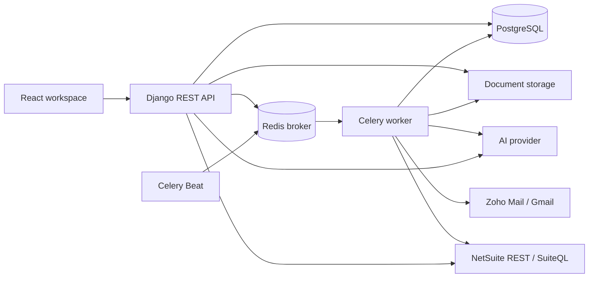

# AGSuite ERP

AGSuite ERP is a multi-tenant application for invoice capture, review, and Oracle NetSuite integration. It helps finance teams turn uploaded documents and incoming vendor emails into structured, validated Vendor Bills while retaining document versions, processing history, and posting results.

The platform includes a company workspace for administrators and employees, plus a Super Admin portal for managing tenants and subscriptions.

## Contents

- [Capabilities](#capabilities)
- [Processing workflow](#processing-workflow)
- [Architecture](#architecture)
- [Repository layout](#repository-layout)
- [Local development](#local-development)
- [Configuration](#configuration)
- [Docker](#docker)
- [Testing](#testing)
- [Deployment and operations](#deployment-and-operations)
- [Troubleshooting](#troubleshooting)
- [Development guidelines](#development-guidelines)

## Capabilities

| Area | Capabilities |
| --- | --- |
| Document processing | PDF and image extraction, multiple-file and ZIP uploads, configurable templates, header and line-item fields, document review and version history |
| AI configuration | Company-level provider and model configuration for Google Gemini, OpenAI, and Anthropic |
| NetSuite | OAuth connections, employee connection assignments, field mapping, live reference validation, Vendor Bill posting, and background batch jobs |
| Email automation | Zoho Mail and Gmail connections, scheduled fetching, message staging and deduplication, vendor-bill processing, and validation/posting results |
| Access management | Company-scoped access, roles, invitations, JWT authentication, email OTP, and company lifecycle controls |
| Administration | Subscription plans, tenant administration, configurable navigation, notifications, audit records, and operational monitoring |

## Processing workflow

### Document uploads

1. Select an extraction template and upload documents.
2. Extract structured header and line-item data using the company's AI configuration.
3. Apply template defaults and enrich mapped references from NetSuite.
4. Review and save the extracted data; calculate applicable line totals and taxes.
5. Validate vendor, item, and other mapped references against the connected NetSuite account.
6. Post a validated Vendor Bill and retain its internal ID and NetSuite record link in history.

### Automated email processing

Connect a mailbox, select its extraction template, and choose an initial synchronization date and time. Background workers fetch and stage messages, identify vendor bills, and create document history records. Valid bills proceed through validation and posting; failures remain available for review.

The default mailbox interval is **5 minutes**. Celery Beat checks for due mailboxes every **1 minute** and dispatches a separate health heartbeat every **30 seconds**. The displayed next-check time is the mailbox's eligibility time: execution occurs on the next scheduler check and may be delayed further by worker load or provider response time.

### Field precedence and NetSuite references

- Configured template defaults replace AI-extracted values for their fields.
- Missing mapped subsidiary and location values can be filled from an unambiguously matched vendor's NetSuite record. Existing values are preserved by this vendor fallback.
- When subsidiary and currency are mapped, the subsidiary's base currency replaces the extracted or template currency. Posting fetches currency again using the final resolved subsidiary and sends the NetSuite currency internal ID.
- A failed subsidiary-currency lookup during enrichment clears the old currency value. A failed lookup during posting prevents the bill from being submitted.
- A missing invoice number receives a database-allocated `vendor_bill_inv_<number>` on initial save. Location is resolved through extraction, configuration, or vendor enrichment; there is no hard-coded location default.

Reference lookup and posting depend on the connected account's records, permissions, and transaction rules.

## Architecture



| Component | Technology / responsibility |
| --- | --- |
| Frontend | React 19, Vite 8, React Router, Tailwind CSS, Axios |
| API | Django 6, Django REST Framework, SimpleJWT |
| Database | PostgreSQL for application data, document history, and durable job state |
| Background processing | Celery and Redis; Celery Beat for scheduled work |
| Document storage | Local filesystem, PostgreSQL-backed storage, or S3-compatible storage |
| Deployment | Gunicorn for the API; Nginx for the Docker frontend and reverse proxy |

Automated email processing requires Redis, a Celery worker, and Celery Beat. OCR and NetSuite batch processing also support an in-process execution mode and a dedicated PostgreSQL-backed worker through `run_ocr_worker`. These alternatives do not replace the email scheduler.

Company-scoped services and access controls separate tenant data. Integration credentials and AI API keys use field-level encryption. Keep the encryption key available to every process that reads those records.

## Repository layout

```text
backend/
  config/             Settings, API routes, WSGI, and Celery configuration
  accounts/           Authentication, user profiles, and login workflows
  tenancy/            Companies and tenant lifecycle
  rbac/               Roles and access configuration
  invitations/        User invitation and acceptance workflows
  subscriptions/      Plans and company subscriptions
  superadmin/         Platform administration
  ocr/                Extraction, templates, document history, storage, and jobs
  netsuite/           OAuth, reference validation, mapping, and posting
  mail_integration/   Mailbox connections, synchronization, and bill pipeline
  audit/              Audit records and notifications
  monitoring/         Health, readiness, errors, and API usage
  common/             Shared services and utilities
  dashboard/          Dashboard data
  navigation/         Configurable navigation
  transactions/       Transaction records
frontend/
  src/                Pages, components, routes, contexts, and API services
Dockerfile.backend    Backend container image
Dockerfile.frontend   Frontend build and Nginx image
docker-compose.yml    Local container services and worker profiles
nginx.conf            Frontend serving and API proxy configuration
```

## Local development

### Prerequisites

- Python 3.12 or later; the backend container uses Python 3.12.
- Node.js 22.12 or later and npm.
- PostgreSQL and a development database.
- Redis when running Celery or automated email processing.
- Provider credentials for the integrations you intend to exercise.

Run the following commands from the repository root unless a step changes directories. Examples use PowerShell.

### 1. Prepare the backend

```powershell
python -m venv .venv
.\.venv\Scripts\Activate.ps1
python -m pip install -r backend/requirements.txt
Copy-Item backend/.env.example backend/.env
```

On Linux or macOS, activate with `source .venv/bin/activate` and copy files with `cp`.

The backend example is production-oriented. Before starting locally, update `backend/.env` with development settings:

```dotenv
DJANGO_SETTINGS_MODULE=config.settings.local
DEBUG=True
DJANGO_DEBUG=True
SECRET_KEY=<generated-django-secret>
FIELD_ENCRYPTION_KEY=<generated-fernet-key>
DATABASE_URL=postgresql://<user>:<password>@localhost:5432/<development_database>
ALLOWED_HOSTS=localhost,127.0.0.1
CORS_ALLOWED_ORIGINS=http://localhost:5173
CSRF_TRUSTED_ORIGINS=http://localhost:5173
FRONTEND_URL=http://localhost:5173
SECURE_SSL_REDIRECT=False
JWT_AUTH_COOKIE_SECURE=False
JWT_AUTH_COOKIE_SAMESITE=Lax
NETSUITE_REDIRECT_URI=http://localhost:8000/api/v1/netsuite/callback/
EMAIL_OAUTH_REDIRECT_URI=http://localhost:8000/api/v1/email/callback/
CELERY_BROKER_URL=redis://localhost:6379/0
CELERY_RESULT_BACKEND=redis://localhost:6379/0
```

Generate the two keys separately:

```powershell
python -c "from django.core.management.utils import get_random_secret_key; print(get_random_secret_key())"
python -c "from cryptography.fernet import Fernet; print(Fernet.generate_key().decode())"
```

Replace the example SMTP/Brevo credentials with working development credentials. To use console email delivery locally, leave `EMAIL_HOST` and `BREVO_API_KEY` empty. Register the exact OAuth callback URLs with the relevant providers; use an approved HTTPS development callback where required by provider configuration.

```powershell
cd backend
python manage.py migrate
python manage.py seed_rbac
python manage.py createsuperuser
python manage.py runserver
```

The API is available at `http://localhost:8000`, with application routes under `/api/v1/`.

### 2. Start background services

Start Redis. In separate terminals, activate the same virtual environment, change to `backend/`, and run:

```powershell
python -m celery -A config worker --loglevel=info --pool=solo
```

```powershell
python -m celery -A config beat --loglevel=info
```

`--pool=solo` is intended here for local Windows development. Keep both processes running for email automation, using the same database, encryption key, and broker configuration as the API. Restart workers after backend changes.

For a dedicated OCR/NetSuite worker without Celery, set `OCR_EXECUTION_MODE=external` and run `python manage.py run_ocr_worker`. Email automation still needs Celery and Beat.

### 3. Start the frontend

In a separate terminal from the repository root:

```powershell
cd frontend
npm ci
Copy-Item .env.example .env
```

Set the following in `frontend/.env`:

```dotenv
VITE_API_BASE_URL=http://localhost:8000/api/v1
```

```powershell
npm run dev
```

Open `http://localhost:5173`. Configure the company, AI provider, NetSuite connection, and extraction template before processing documents. Automated email processing additionally requires an active mailbox and initial sync date.

## Configuration

| Variable | Purpose |
| --- | --- |
| `DJANGO_SETTINGS_MODULE` | Select `config.settings.local`, `config.settings.production`, or dedicated test settings |
| `DATABASE_URL` | PostgreSQL connection string; local configuration also supports `LOCAL_DATABASE_URL` as a fallback |
| `SECRET_KEY` | Django application secret |
| `FIELD_ENCRYPTION_KEY` | Fernet key for encrypted integration credentials and API keys |
| `ALLOWED_HOSTS` | Allowed backend hostnames |
| `CORS_ALLOWED_ORIGINS`, `CSRF_TRUSTED_ORIGINS`, `FRONTEND_URL` | Browser origins and frontend URL |
| `NETSUITE_REDIRECT_URI`, `EMAIL_OAUTH_REDIRECT_URI` | Provider-registered OAuth callbacks |
| `EMAIL_HOST`, `EMAIL_HOST_USER`, `EMAIL_HOST_PASSWORD`, `BREVO_API_KEY` | Outbound delivery for OTPs and invitations; separate from mailbox OAuth |
| `CELERY_BROKER_URL`, `CELERY_RESULT_BACKEND` | Celery broker and result service |
| `OCR_EXECUTION_MODE` | Job execution strategy: `auto`, `celery`, `thread`, `inline`, or `external` |
| `OCR_STORAGE_BACKEND` | Document storage: `auto`, `local`, `db`, or `s3` |
| `OCR_S3_*` | S3 bucket, region, endpoint, and optional credentials |
| `VITE_API_BASE_URL` | Frontend API endpoint, embedded at build time |

Use the environment templates as starting points: [backend](backend/.env.example), [frontend](frontend/.env.example), [Docker application](env.docker.example), and [Docker PostgreSQL](env.postgres.example). Runtime settings are defined in `backend/config/settings/`.

Store secrets outside version control. Back up the encryption key securely with your recovery procedures; replacing it without migrating encrypted values makes existing credentials unreadable.

## Docker

Copy both environment templates from the repository root:

```powershell
Copy-Item env.docker.example .env.docker
Copy-Item env.postgres.example .env.postgres
```

Fill in the application keys and database credentials. Keep the PostgreSQL password consistent between both files. The supplied database health check expects `agsuite_user` and `agsuite_erp`; update it if you change those names.

For email automation, enable the following values in `.env.docker`:

```dotenv
CELERY_BROKER_URL=redis://redis:6379/0
CELERY_RESULT_BACKEND=redis://redis:6379/0
REDIS_URL=redis://redis:6379/0
```

Set OAuth callbacks to the externally reachable API URL. With the supplied Nginx configuration and local port 80, callbacks use `http://localhost/api/v1/...`; the backend port is not published directly. Configure outbound email credentials or clear unused example values before starting.

```powershell
docker compose --profile full up -d --build
docker compose ps
docker compose logs -f backend celery_worker celery_beat
```

The frontend is served at `http://localhost`. The backend entrypoint applies migrations, seeds roles, and collects static files.

| Profile | Services |
| --- | --- |
| Default | Frontend, backend, PostgreSQL, Redis, and static-volume initialization |
| `full` | Default services plus Celery worker and Beat |
| `worker` | Default services plus the dedicated OCR/NetSuite worker; use `OCR_EXECUTION_MODE=external` |

Named volumes retain database, Redis, media, and static data. `docker compose down` stops the stack; adding `--volumes` deletes those volumes.

## Testing

Run backend checks from `backend/` with the virtual environment active:

```powershell
python manage.py check
python manage.py test netsuite.tests ocr.tests mail_integration.tests --noinput
```

For the full suite, use a dedicated PostgreSQL test server and the repository's test settings. The test user must be able to create the separate test database:

```powershell
$env:DJANGO_SETTINGS_MODULE = "config.settings.testing"
$env:TEST_DATABASE_URL = "postgresql://<test_user>:<password>@localhost:5432/postgres"
$env:TEST_DATABASE_NAME = "test_agsuite"
python manage.py test --noinput
```

Use a separate terminal for these settings so subsequent development commands retain their development configuration.

From `frontend/`:

```powershell
npm run lint
npm run build
```

Integration acceptance checks should cover login, a document upload, mapped-field validation, and a Vendor Bill posted to a NetSuite sandbox. For email changes, also check scheduled fetching, duplicate handling, and failure visibility in history. Mocked unit tests do not verify account-specific NetSuite permissions or provider behavior.

## Deployment and operations

Deploy the API, frontend, database, document storage, and required workers as separate operational components. Use persistent/shared document storage when running multiple instances. For automated email workflows, keep Redis, workers, and a single active Beat scheduler available.

A release should apply database migrations, collect static assets, rebuild the frontend with the target API URL, and restart backend workers. Configure HTTPS, allowed hosts, browser origins, and provider callbacks for the target environment. Production uses `config.settings.production`; run `python manage.py check --deploy` with the production environment before rollout.

| Endpoint / command | Purpose |
| --- | --- |
| `GET /health/` | Basic API liveness |
| `GET /api/v1/monitoring/health/` | Application dependency diagnostics |
| `GET /api/v1/monitoring/readiness/` | Readiness check |
| `python manage.py run_ocr_worker` | Dedicated OCR and NetSuite job worker |
| `python manage.py run_scheduled_tasks` | Housekeeping when scheduled outside Celery Beat |

Monitor mailbox due times and completion results alongside worker and scheduler health. A healthy API alone does not establish that email processing is running. Maintain backups of PostgreSQL, uploaded documents, and encryption keys, and verify restoration in a separate environment.

Additional deployment notes are available in [DEPLOY.md](DEPLOY.md) and [DEPLOY_ANYWHERE.md](DEPLOY_ANYWHERE.md). For exact service profiles, defaults, and supported options, consult the checked-in Compose file and settings modules.

## Troubleshooting

| Symptom | Check |
| --- | --- |
| API returns `DisallowedHost` | Backend hostname in `ALLOWED_HOSTS` |
| Browser reports CORS/CSRF errors | Frontend origin, trusted origins, cookie settings, and HTTP/HTTPS consistency |
| Frontend calls the wrong API | `VITE_API_BASE_URL` at build time; rebuild after changing it |
| Email passes its displayed due time | Next one-minute scheduler check, worker queue, connection state, and provider response |
| Sync reports `checked: 0` | No mailbox met the active, connected, unpaused, initialized, and due filters |
| Mailbox requires authorization | Reconnect through provider OAuth to restore valid credentials |
| Currency enrichment or posting fails | Subsidiary mapping, subsidiary record, currency availability, and SuiteQL permissions |
| NetSuite rejects a reference | Record status, subsidiary compatibility, field mapping, and integration-role permissions |
| Uploaded files disappear after a restart | Storage persistence and shared access between API and workers |
| Jobs remain queued | Execution mode, worker availability, broker configuration, and job logs |

## Development guidelines

Keep tenant scoping and authorization in place when adding endpoints or background jobs. Add migrations for model changes and focused tests for behavior changes. Validate integration changes with sandbox accounts before production use.

Keep credentials, OAuth tokens, customer documents, and environment files out of commits and diagnostic output. Update this README when setup, supported workflows, or operational requirements change; document deployment-specific configuration in the corresponding environment's runbook.
